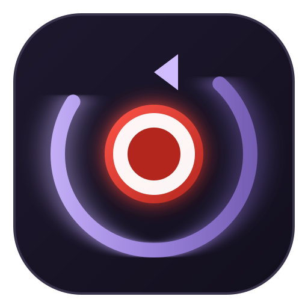
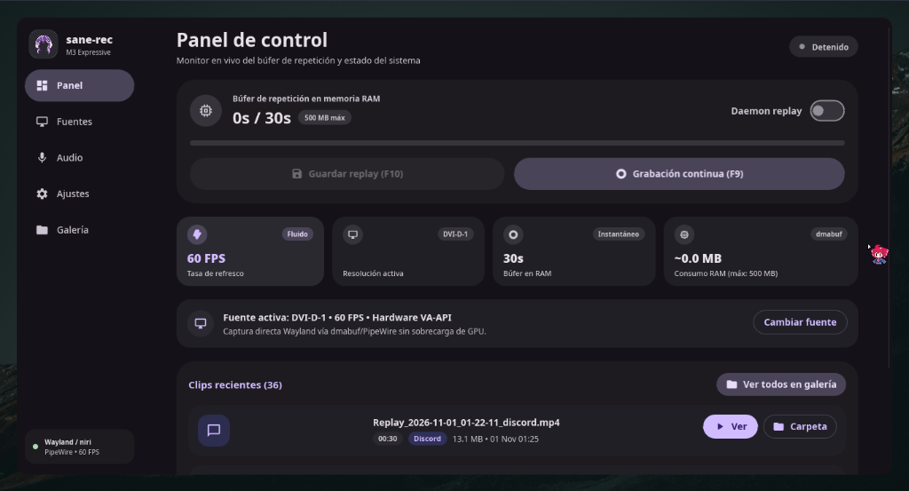
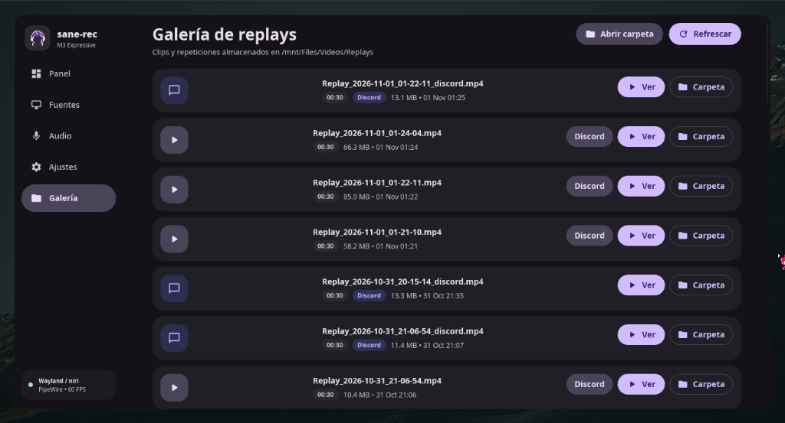
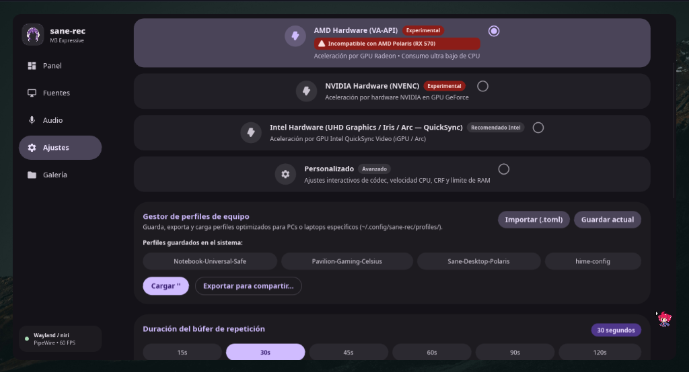
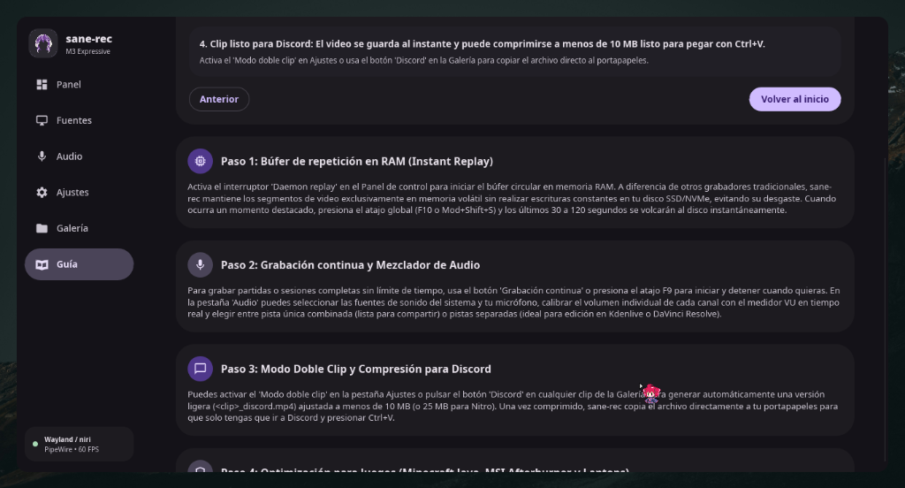
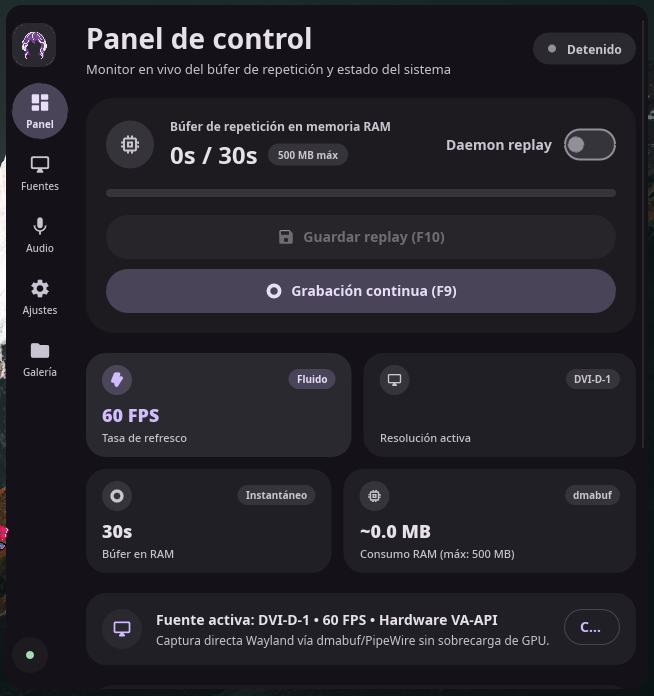

<p align="center">
  
</p>

<h1 align="center">sane-rec</h1>

<p align="center">
  <strong>Grabador de pantalla ligero y búfer de repetición instantánea (Instant Replay) multiplataforma</strong><br>
  Diseñado con arquitectura CPU-First, cero desgaste de SSD y una interfaz Material Design 3 Expressive construida con Slint.
</p>

<p align="center">
  <a href="https://github.com/RCarrascoO/sane-rec/releases"></a>
  <a href="https://github.com/RCarrascoO/sane-rec"></a>
  <a href="LICENSE"></a>
  <a href="https://www.rust-lang.org/"></a>
</p>

---

## 📸 Galería de la Interfaz

| Panel Principal (M3 Expressive) | Galería de Replays & Discord |
| :---: | :---: |
|  |  |
| *Estado en vivo, vúmetros y acceso rápido* | *Gestión de clips, compresión y eliminación* |

| Ajustes & Perfiles Térmicos | Guía Interactiva & Novedades |
| :---: | :---: |
|  |  |
| *Configuración de audio, atajos y codificadores* | *Tutorial paso a paso y visor de changelog integrado* |

<p align="center">
  <strong>Modo Compacto (Mini UI Flotante)</strong><br>
  
</p>

---

## ✨ Características Principales

### ⚡ Repetición Instantánea en RAM (Zero SSD Wear)
Guarda tus jugadas y mejores momentos de los últimos **15, 30, 45, 60, 90 o 120 segundos** al presionar un atajo global o un clic:
- **Linux:** Búfer rodante segmentado alojado directamente en memoria compartida (`/dev/shm`), evitando escrituras innecesarias en el almacenamiento secundario.
- **Windows:** Búfer circular en RAM física (`VecDeque`) gestionado a través de tuberías anónimas de alta velocidad.
- Los datos solo se consolidan en tu disco SSD/NVMe cuando decides explícitamente guardar el clip.

### 💬 Modo Doble Clip & Compresión Inteligente para Discord (< 10 MB)
Olvídate de recortar clips a mano o suscribirte a planes de pago solo para compartir jugadas:
- Genera en segundo plano una copia ligera optimizada (`_discord.mp4`) calculando bitrates dinámicos y aplicando escalado adaptativo inteligente (**1080p → 720p → 480p**).
- **Copia instantánea al portapapeles:** Copia automáticamente la ruta del clip comprimido (`wl-copy` en Linux, `Set-Clipboard` en Windows). Basta con presionar `Ctrl + V` en Discord o cualquier red social.

### 🛡️ Arquitectura CPU-First & Perfiles de Hardware
Creado para máxima estabilidad tanto en CPU como con aceleración de GPU sin sobrecalentamientos:
- **`Polaris-VAAPI-ZeroBFrames` (AMD Polaris RX 470/480/570/580):** Soporte de codificación nativa por GPU (`h264_vaapi`) con Zero B-Frames (`-b 0`) bajo Linux Wayland. Captura a 60 FPS con solo ~3% de CPU y cero cuelgues del driver de video (`ring vce0 timeout`).
- **`Sane Safe` (CPU x264 zerolatency):** Codificación por CPU con latencia cero sin depender del codificador de video de la GPU.
- **`Pavilion Gaming - Celsius`:** 0% de carga en la tarjeta dedicada (dGPU) en portátiles de juego bajo Windows (HP Pavilion, ASUS TUF, Lenovo Legion), evitando estrangulamiento térmico (*thermal throttling*), sobrecalentamiento y pantallas azules (BSODs).
- **Soporte de Hardware Completo:** Incluye presets adaptativos para **NVIDIA NVENC (p1–p4)**, **AMD AMF / VA-API**, **Intel QuickSync** y **libvpx-vp9** con mapeo inteligente de calidad QP / CRF.

### 🎮 Compatibilidad Total con Juegos (Minecraft Java & MSI Afterburner / RTSS)
- Captura fluida en Windows vía `gdigrab` Desktop DWM y DXGI sin perder el foco en títulos OpenGL / Java como Minecraft (evita la apertura no deseada del menú `ESC`).
- Compatible con **RivaTuner Statistics Server (RTSS)** y **MSI Afterburner** sin colisiones de hooking 3D.
- Ejecución de procesos auxiliares 100% silenciosa en Windows (`CREATE_NO_WINDOW`), eliminando cualquier parpadeo de consola.

### 🎨 Material Design 3 Expressive (Slint 1.8)
- Estética limpia inspirada en Google Pixel / Android 14.
- Modo compacto colapsable para dejar la aplicación en una esquina de la pantalla.
- Medidores VU de audio en tiempo real para escritorio y micrófono con balance independiente.
- Gestión de clips: apertura en reproductor predeterminado, recompresión manual para Discord y eliminación segura en dos toques.
- Guía interactiva integrada y visualizador de notas de la versión.

### 🚀 Auto-Actualizador Nativo en 1 Clic
- Verificación no bloqueante con [GitHub Releases](https://github.com/RCarrascoO/sane-rec/releases).
- Notificación visual elegante en el encabezado.
- Actualización atómica en caliente tanto en **Linux** (`.tar.gz`) como en **Windows** (instalador `.exe` silencioso o actualización binaria en la versión portable `.zip`).

---

## 📦 Instalación

### 🪟 Windows 10 / 11

Elige la opción que prefieras desde [GitHub Releases](https://github.com/RCarrascoO/sane-rec/releases/latest):

1. **Instalador Oficial (`sane-rec-setup-x64.exe` - Recomendado):**
   - Incluye binario de `ffmpeg.exe` estático listo para usar (no requiere configurar PATH).
   - Genera accesos directos en el Menú Inicio y en el Escritorio.
   - Incluye desinstalador limpio y soporte para auto-actualizaciones silenciosas en 1 clic.
2. **Versión Portable (`sane-rec-windows-x64-portable.zip`):**
   - Simplemente descomprime la carpeta y ejecuta `sane-rec.exe`.
   - Incluye FFmpeg en el mismo directorio.
   - Ideal para llevar en un pendrive o no tocar el registro del sistema.

---

### 🐧 Linux (Wayland)

#### Requisitos del Sistema
- `wf-recorder` (captura por dmabuf/PipeWire)
- `ffmpeg` (multiplexado y codificación rápida)
- `pipewire` y herramientas PulseAudio (`pactl` / `pulseaudio-utils`)

**En Arch Linux / CachyOS:**
```bash
sudo pacman -S wf-recorder ffmpeg pipewire-pulse
```

**En Ubuntu / Debian:**
```bash
sudo apt install wf-recorder ffmpeg pulseaudio-utils
```

**En Fedora:**
```bash
sudo dnf install wf-recorder ffmpeg pulseaudio-utils
```

---

#### ⚡ Instalación en 1 Línea (Linux)
Descarga la versión precompilada más reciente, instala el binario en `~/.local/bin`, su icono SVG y el acceso de escritorio `.desktop`:

```bash
curl -fsSL https://raw.githubusercontent.com/RCarrascoO/sane-rec/main/install.sh | bash
```

*(Asegúrate de que `~/.local/bin` forme parte de tu variable `$PATH`).*

---

#### 🛠️ Compilación desde el Código Fuente
Requiere Rust 1.75+ con cargo:

```bash
# Clonar el repositorio
git clone https://github.com/RCarrascoO/sane-rec.git
cd sane-rec

# Compilar en modo Release
cargo build --release

# Instalar binario, icono y acceso en el sistema
./install.sh
```

---

## ⌨️ Atajos de Teclado Globales

`sane-rec` registra atajos de teclado globales tanto en Linux como en Windows:

| Acción | Atajo Predeterminado | Comportamiento |
| :--- | :--- | :--- |
| **Guardar Replay Instantáneo** | `Alt + F10` (Windows) / `Mod + F10` (Wayland) | Concatena y guarda el búfer de RAM en disco |
| **Alternar Grabación Continua** | `Alt + F9` (Windows) / `Mod + F9` (Wayland) | Inicia o detiene la grabación continua |

> [!TIP]
> Los atajos son totalmente configurables desde la pestaña **Ajustes** dentro de la aplicación. En Windows se admiten combinaciones con `Ctrl`, `Alt`, `Shift` y teclas extendidas (`F1` a `F24`, `Insert`, `Delete`, `Home`, `End`, `PageUp`, `PageDown` y teclado numérico). En Wayland, se pueden inyectar automáticamente en las configuraciones de `niri`, `Sway` o `Hyprland`.

---

## 💻 Comandos de Consola (CLI & IPC)

`sane-rec` incluye control completo por línea de comandos que se comunica mediante sockets IPC locales:

```bash
sane-rec save               # Guarda un replay instantáneo desde la terminal o script
sane-rec record             # Alterna la grabación continua (toggle)
sane-rec record start       # Inicia la grabación continua
sane-rec record stop        # Detiene la grabación continua
sane-rec status             # Consulta el estado en tiempo real del motor y búfer
sane-rec update             # Comprueba y actualiza a la última versión disponible
sane-rec daemon             # Inicia el motor en segundo plano sin interfaz gráfica
```

---

## 📋 Novedades

Consulta el archivo [CHANGELOG.md](CHANGELOG.md) para ver la lista detallada de cambios de cada versión.

---

## 📄 Licencia

Este proyecto está publicado bajo la licencia dual:
- [Licencia MIT](LICENSE)
- [Licencia Apache 2.0](LICENSE)
