# Hallazgo Técnico: Codificación por Hardware `VA-API` Estable en AMD Radeon RX 570 / 580 (`Polaris 10` / `VCE 3.4`) en Linux Wayland

> [!IMPORTANT]
> **Fecha del hallazgo:** 1 de noviembre de 2026  
> **Hardware verificado:** AMD Radeon RX 570 8GB GDDR5 (`Polaris 10` / `GCN 4.0`, PCI ID `1002:67df`) + AMD Ryzen 5 5500  
> **Entorno:** CachyOS Linux (`kernel 6.18-cachyos` BORE) + `niri` (Wayland) + Mesa `radeonsi` (`VA-API`)  
> **Software:** `sane-rec` (`wf-recorder` + `ffmpeg` + PipeWire)  
> **Resultado:** Grabación continua por hardware GPU (`h264_vaapi`) a **60 FPS** con solo **~3% de uso de CPU** y **0 cuelgues del kernel (`ring vce0 timeout`)**.

---

## 1. El Mito / Problema Histórico en Linux con las RX 470 / 480 / 570 / 580 (Polaris)

Históricamente, en Linux (especialmente en sesiones Wayland), activar la codificación de video por hardware **VA-API (`h264_vaapi`)** en tarjetas gráficas de la familia **AMD Polaris 10 / 20** (muy comunes en el mercado de segunda mano y ex-minería) utilizando OBS Studio, FFmpeg estándar o clientes WebRTC (Discord/Vesktop) provocaba un bloqueo catastrófico e irreversible del sistema en cuestión de segundos:

```text
[drm:amdgpu_job_timedout [amdgpu]] *ERROR* ring vce0 timeout, signaled seq=..., emitted seq=...
[drm:amdgpu_device_ip_suspend_phase2 [amdgpu]] *ERROR* suspend of IP block <vce_v3_0> failed -22
amdgpu 0000:01:00.0: GPU reset begin!
```

Como el bloque físico **`vce_v3_0` (`VCE 3.4`)** en el silicio Polaris no soporta *soft-reset* limpio en caliente en el driver `amdgpu` (`suspend failed -22`), cualquier timeout en `ring vce0` congelaba inmediatamente todos los monitores y obligaba a apagar la PC por botón físico (REISUB / corte de energía).

Debido a esto, se asumía que el codificador físico de las RX 570 estaba "roto en Linux" o "dañado por BIOS de minería". **Esa suposición era incorrecta.**

---

## 2. Causa Raíz Real: ¿Por qué crashea `VCE 3.4` en OBS/FFmpeg estándar y por qué NO crashea en `sane-rec`?

```mermaid
flowchart TD
    subgraph Fallo_Tradicional["Flujo Tradicional (OBS / FFmpeg default / Vesktop) -> CRASH"]
        A1["Captura Wayland Portal"] --> A2["Copia a contexto OpenGL/Vulkan intermedio<br/>(libgallium / recomposición de escena)"]
        A2 --> A3["Encoder h264_vaapi con B-Frames por defecto<br/>(max_b_frames = 1..2)"]
        A3 --> A4["VCE 3.4 retiene múltiples surfaces NV12 en VRAM<br/>esperando frames futuros para reordenamiento B-frame"]
        A4 --> A5["SMU de Polaris cambia reloj MCLK (GDDR5)<br/>mientras ring vce0 tiene referencias cruzadas"]
        A5 --> A6["💥 DEADLOCK: ring vce0 timeout (-22)<br/>Congelamiento total del PC"]
    end

    subgraph Flujo_SaneRec["Flujo sane-rec (Zero-Copy + Zero B-Frames) -> ESTABLE"]
        B1["Captura Directa wlr-screencopy / DMA-BUF<br/>(wf-recorder -o DVI-D-1)"] --> B2["Entrega directa de textura al driver VA-API<br/>(Sin contexto 3D OpenGL intermedio)"]
        B2 --> B3["Encoder -c h264_vaapi con flag estricto -b 0<br/>(Cero B-Frames: solo frames I y P secuenciales)"]
        B3 --> B4["VCE 3.4 codifica cada frame en <2 ms en orden lineal<br/>y libera el buffer DMA-BUF inmediatamente"]
        B4 --> B5["✅ Cero retención en VRAM • Cero conflicto con MCLK<br/>3% CPU • 60 FPS estables"]
    end
```



### Los 3 pilares técnicos que evitan el crash en `sane-rec`

#### A. Desactivación estricta de *B-Frames* (`-b 0`) en el motor `VCE 3.4`
- **El límite de hardware:** El motor **Video Coding Engine 3.4 (`VCE 3.4`)** integrado en Polaris 10 (`GCN 4.0`, año 2016/2017) tiene un pipeline de codificación H.264 diseñado para secuencias lineales de baja latencia (`I-frames` y `P-frames` unidireccionales). Su gestión de referencias bidireccionales (*B-frames*) en el driver `radeonsi` de Mesa presenta una condición de carrera en la cola de comandos del firmware `amdgpu/polaris10_vce.bin`.
- **Qué pasa con B-frames activos:** Para codificar un *B-frame*, la GPU debe retener en memoria VRAM varios fotogramas anteriores y posteriores simultáneamente, reordenar los timestamps (`PTS`/`DTS`) y mantener bloqueados los *surfaces* `NV12` mientras el reloj de memoria GDDR5 (`MCLK`) cambia de estado de energía (`DPM`). En tarjetas con timings ajustados o ex-minería, esa retención cruzada bloquea el anillo `vce0`.
- **Qué hace `sane-rec` (`-b 0`):** Al pasar `-c h264_vaapi -b 0`, se instruye a `libavcodec` / `radeonsi_drv_video.so` a establecer `max_b_frames = 0`. Cada fotograma que entra al motor `VCE 3.4` se procesa de forma **estrictamente secuencial (`I -> P -> P -> P`)** en menos de `2 ms` y su memoria se libera al instante antes de que llegue el siguiente fotograma.

#### B. Pipeline *Zero-Copy* directo (`DMA-BUF` → `VA-API`) sin contexto 3D intermedio
- **Por qué fallan OBS y Vesktop:** Ambos abren un contexto gráfico 3D (`OpenGL` / `Vulkan` sobre `ring gfx`) para componer capas, escalar o convertir colores antes de exportar la textura hacia `VA-API` (`ring vce0`). Esa sincronización entre el anillo gráfico 3D (`gfx`) y el anillo de video (`vce0`) sobre el mismo `DMA-BUF` con compresión Delta Color Compression (DCC) de AMD corrompe el estado en `libgallium` (`vesktop:cs0 SIGABRT`).
- **Qué hace `sane-rec`:** Utiliza `wf-recorder` acoplado directamente a la salida del compositor (`-o DVI-D-1`). El frame capturado pasa por el descriptor `DMA-BUF` directamente al codificador `VA-API` sin crear un segundo contexto 3D competitivo.

#### C. Direct Scanout en el compositor Wayland (`niri`)
- Al tener configuradas las reglas de ventana en `niri` sin recorte de esquinas redondeadas (`geometry-corner-radius 0`, `clip-to-geometry false`) y sin inyección de shaders `FSR4` (`PROTON_FSR4_UPGRADE=0`), el bus de memoria GDDR5 de 256 bits no sufre saturación por copias intermedias del compositor, manteniendo los estados de reloj de la RX 570 limpios.

---

## 3. Comando y Parámetros Exactos Verificados

El comando exacto generado por `sane-rec` en [src/engine.rs](file:///mnt/Files/Proyectos/sane-rec/src/engine.rs) que demostró estabilidad total en la RX 570 es:

```bash
wf-recorder \
  -y \
  -o DVI-D-1 \
  -asane_rec_mix.monitor \
  -C aac \
  -c h264_vaapi \
  -b 0 \
  -f /mnt/Files/Videos/Replays/Recording.mp4
```

Y para el **Búfer de Repetición Instantánea en RAM (`/dev/shm`)** por segmentos:

```bash
wf-recorder \
  -o DVI-D-1 \
  -f /dev/shm/sane-rec-buffer-1000/seg_%05d.mp4 \
  -c h264_vaapi \
  -r 60 \
  -b 0 \
  -g 1360x768 \
  -p muxer=segment \
  -p segment_time=3 \
  -p segment_wrap=24 \
  -p reset_timestamps=1 \
  -asane_rec_mix.monitor \
  -C aac
```

### Equivalente si se invoca `ffmpeg` directamente con `VA-API` en una RX 570/580:
Siempre que se utilice `ffmpeg` con `h264_vaapi` en una GPU AMD Polaris, **es obligatorio pasar `-bf 0`** (equivalente a `-b 0` de `wf-recorder`):

```bash
ffmpeg -vaapi_device /dev/dri/renderD128 \
  -f kmsgrab -i - \
  -vf 'hwmap=derive_device=vaapi,scale_vaapi=format=nv12' \
  -c:v h264_vaapi -bf 0 -qp 22 \
  output.mp4
```

---

## 4. Comparativa de Rendimiento en el Equipo de `sane` (`Ryzen 5 5500` + `RX 570 8GB`)

| Modo en `sane-rec` | Codificador | Uso de CPU (`sane-rec` + encoder) | Uso de GPU (`VCE 3.4`) | Estabilidad en RX 570 | Caso de Uso Ideal |
| :--- | :--- | :--- | :--- | :--- | :--- |
| **`Sane Safe (CPU x264)`** | `libx264` (`ultrafast`, `zerolatency`, `-b 0`) | `~8% – 14%` (repartido en 4 hilos del Ryzen 5 5500) | **`0%`** (`VCE 3.4` apagado) | **100% Inmune** | Juegos AAA pesados en Vulkan donde la GPU esté al 99% de carga 3D y VRAM al límite. |
| **`AMD Hardware (VA-API)` con `-b 0`** | `h264_vaapi` (`-b 0`, sin B-frames) | **`~2.5% – 3.5%`** (casi nulo) | Activo (`ring vce0` lineal sin retención) | **Estable** (gracias a `-b 0` y captura directa `dmabuf`) | Grabación de escritorio, juegos competitivos (Minecraft, LoL, CS2, indies) o sesiones largas con **0% de impacto en el procesador**. |
