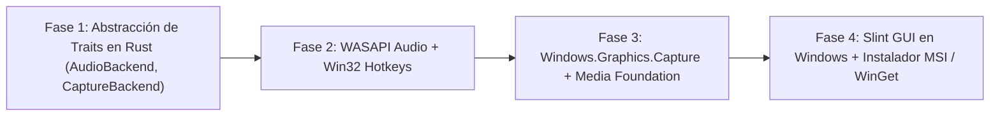

# Estudio Técnico de Portabilidad a Windows 10/11: Arquitectura de sane-rec

**Documento:** `docs/WINDOWS_PORT_STUDY.md`  
**Estado:** Roadmap Post-Linux v1.0.0  
**Objetivo:** Especificación de arquitectura, APIs nativas y plan de transición para portar sane-rec a Windows 10 y Windows 11 conservando la filosofía de bajo consumo, cero sobrecarga y estética Material Design 3.

---

## 1. Resumen Ejecutivo y Viabilidad

El stack central de `sane-rec` en Rust (lógica de negocio, gestión de configuración TOML, serialización serde, IPC local y la interfaz gráfica Slint) es **100% multiplataforma**.  
El esfuerzo de portabilidad se concentra exclusivamente en los tres subsistemas dependientes del sistema operativo:
1. **Captura de Pantalla y Ventanas:** Reemplazar Wayland / PipeWire / `wf-recorder` por la API moderna de **Windows.Graphics.Capture (WGC)** de WinRT / DirectX 11.
2. **Subsistema de Audio:** Reemplazar los sinks y loopbacks de PipeWire por **WASAPI Loopback (Windows Audio Session API)**.
3. **Atajos Globales de Teclado:** Reemplazar los binds de Niri Wayland por la API Win32 de **`RegisterHotKey`**.

---

## 2. Captura de Video: `Windows.Graphics.Capture` (WGC)

### 2.1 Limitaciones de APIs Antiguas vs WGC
- `GDI BitBlt`: Inviable (menos de 15 FPS, alto uso de CPU, no captura juegos DirectX).
- `Desktop Duplication API (DXGI)`: Eficiente, pero requiere privilegios elevados y no permite capturar ventanas individuales ni juegos en modo ventana de forma limpia.
- **`Windows.Graphics.Capture` (WGC)**: La API oficial recomendada por Microsoft (Windows 10 1803+ y Windows 11). Es la misma que utilizan OBS Studio y Xbox Game Bar.

### 2.2 Flujo de Datos y Pipeline Zero-Copy
```
[Pantalla / Ventana / Juego]
             │ (Windows.Graphics.Capture)
             ▼
[Direct3D 11 Texture2D (GPU VRAM)]
             │
             ├── Opción A (Hardware GPU): Media Foundation SinkWriter / NVENC / AMF
             │
             └── Opción B (Sane Safe CPU): ID3D11DeviceContext::Map -> RAM -> libx264
```

1. **Creación del CaptureItem:** A través de `GraphicsCaptureItemInterop::CreateForWindow` (captura por ventana) o `CreateForMonitor` (monitor completo).
2. **Buffer Frame Pool:** `Direct3D11CaptureFramePool` entrega superficies `IDirect3DSurface` a 60 FPS sincrónicas con el refresco de pantalla.
3. **Modo Libre de Borde Amarillo:** En Windows 10 2004+ y Windows 11, se desactiva el recuadro amarillo con `captureSession.IsBorderRequired = false`.

---

## 3. Captura y Mezcla de Audio: WASAPI Loopback

En Linux, sane-rec utiliza `module-null-sink` y `module-loopback` de PipeWire. En Windows, la arquitectura equivalente se implementa con **WASAPI (Windows Audio Session API)**:

### 3.1 Captura del Audio del Sistema / Juego (Loopback)
- Se inicializa el cliente `IMMDeviceEnumerator` apuntando al endpoint de reproducción por defecto (`eRender`, `eMultimedia`).
- Se activa `IAudioClient` con el flag `AUDCLNT_STREAMFLAGS_LOOPBACK`.
- Esto intercepta el flujo PCM estéreo de 32 bits en coma flotante a 48.000 Hz antes de que llegue a los altavoces/auriculares.

### 3.2 Captura del Micrófono
- Se inicializa un segundo `IAudioClient` apuntando al endpoint de captura (`eCapture`).
- Un hilo de mezcla en memoria suma las muestras del micrófono y del sistema aplicando las ganancias de volumen `volume_system` y `volume_mic` configuradas en la interfaz de sane-rec.

---

## 4. Búfer Rodante en Memoria RAM (Instant Replay)

En Linux, sane-rec almacena los segmentos rodantes de 1 segundo en `/dev/shm/` (memoria RAM basada en `tmpfs`).  
En Windows no existe `/dev/shm/` por defecto. Se implementarán dos estrategias:

1. **Estrategia A (Recomendada / Zero-Setup):**
   - Utilizar `%TEMP%\sane-rec\<UID>\` con el flag `FILE_ATTRIBUTE_TEMPORARY` y `FILE_FLAG_DELETE_ON_CLOSE` de Windows.
   - El Administrador de Caché del kernel de Windows (Cache Manager) mantiene automáticamente en memoria RAM estos archivos sin forzar escrituras físicas al SSD mientras haya memoria libre disponible.
2. **Estrategia B (Memoria Compartida Pura):**
   - Utilizar `CreateFileMappingW(INVALID_HANDLE_VALUE, ...)` para crear un búfer circular contiguo de memoria virtual en RAM.

---

## 5. Atajos de Teclado Globales (Win32 API)

Para sustituir la configuración de compositor Wayland (`niri` / `sway`):
- Se registra un hilo de fondo Win32 con mensaje loop que ejecuta:
  ```rust
  RegisterHotKey(hwnd, ID_SAVE_REPLAY, MOD_ALT | MOD_NOREPEAT, VK_F10);
  RegisterHotKey(hwnd, ID_TOGGLE_RECORD, MOD_ALT | MOD_NOREPEAT, VK_F9);
  ```
- Al dispararse `WM_HOTKEY`, se envía la señal de guardado al `ReplayEngine`.
- En caso de juegos que capturen el teclado en modo exclusivo (`RawInput`), se implementa un hook de teclado de bajo nivel opcional con `SetWindowsHookExW(WH_KEYBOARD_LL, ...)`.

---

## 6. Interfaz Gráfica y Empaquetado

- **Slint en Windows:** Slint compila de forma nativa sin ninguna dependencia externa de X11/Wayland. Utiliza el backend Direct3D o Skia con aceleración de hardware completa.
- **Empaquetado:**
  - Binario único `sane-rec.exe`.
  - Empaquetador con **WiX Toolset** o **Inno Setup** para generar un instalador `.msi` / `.exe`.
  - Manifiesto para el catálogo de **WinGet** (`winget install sane-rec`).

---

## 7. Plan de Implementación por Fases (Post-v1.0.0 Linux)



1. **Fase 1 (Modularización de Traits):**
   - Crear traits comunes en `sane-rec`: `trait ScreenCapturer`, `trait AudioMixer`, `trait HotkeyManager`.
   - Mover la implementación actual a `sane_rec::platform::linux::*`.
2. **Fase 2 (Audio y Atajos en Windows):**
   - Implementar `WASAPIAudioMixer` y `Win32HotkeyManager` con los crates oficiales `windows` / `windows-sys`.
3. **Fase 3 (Captura WGC):**
   - Implementar `WgcCapturer` y exportar a códec H.264/AAC.
4. **Fase 4 (Estabilización y Distribución):**
   - Validar compatibilidad en Windows 10 (21H2+) y Windows 11 (22H2+).
